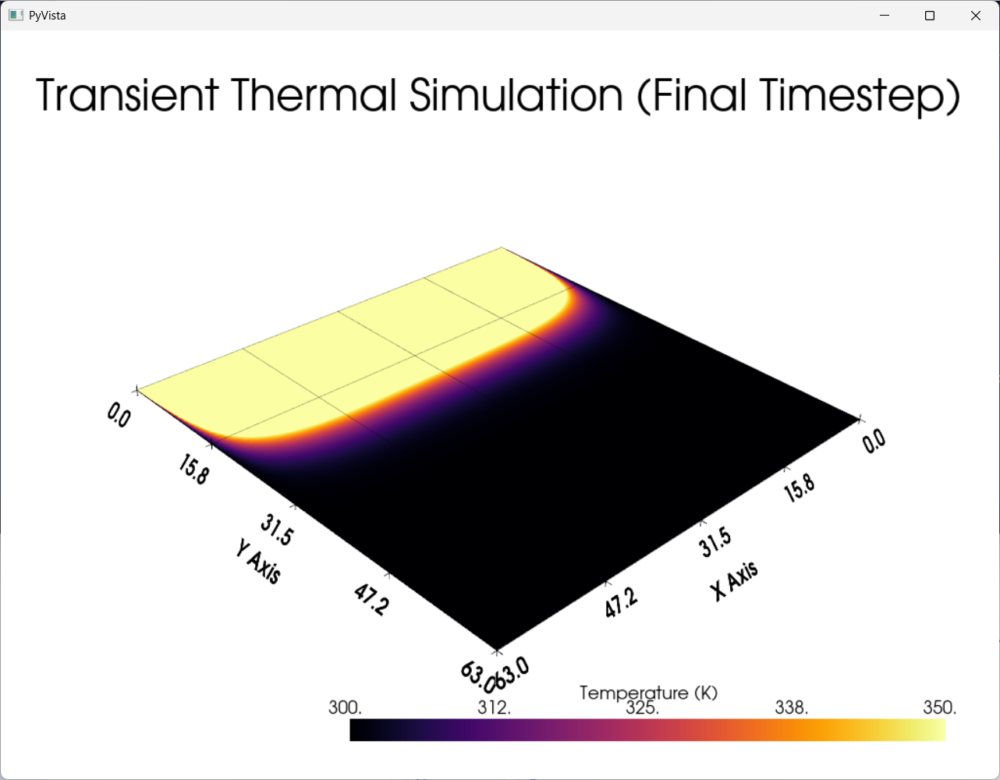

# Physics-Informed Generative Design DSL

A custom Domain-Specific Language (DSL) that compiles human-readable physics constraints into 3D CAD geometry and executes high-performance transient thermal simulations.

## 📖 Overview
This project bridges the gap between declarative text descriptions of engineering components and executable physics simulations. By writing simple text definitions for material stacks and geometries, the engine automatically generates 3D models (STEP/STL) and runs a C-accelerated finite-difference thermal solver to create a "digital twin."

### 📸 Visual Output


**Figure 1:** Thermal Simulation Heatmap

## 🏗️ Architecture
The engine is built in four distinct layers:
1. **The Language (textX):** Parses `.dsl` files into structured Python objects.
2. **The Interpreter:** Routes geometry to the CAD engine and thermal blocks to the physics solver.
3. **The CAD Engine (CadQuery):** Generates precise 3D solids (`.step` and `.stl`) from parsed parameters.
4. **The Physics Engine (C + ctypes):** Executes a 2D transient thermal diffusion kernel written in C for near-native performance, bridged to Python via `ctypes`.

*(For a deep dive into the numerical methods and C-bridge implementation, read the **[Technical Brief](Technical_Brief.md)**).*

## 🚀 Features
* **Declarative Syntax:** Define parts, materials, and interfaces in simple text.
* **Automated 3D Generation:** Exports `.step` and `.stl` files on the fly.
* **C-Accelerated Physics:** Solves thermal diffusion using a 5-point finite-difference stencil.
* **Interactive UI:** A Streamlit web app for real-time compilation, visualization, and file downloading.
* **Rigorously Tested:** 20 passing unit and integration tests covering the parser, interpreter, and C bridge.

## 🛠️ Installation & Setup

1. **Clone the repository:**
   ```bash
   git clone https://github.com/altugrakay-commits/DSL_Syntax.git
   cd DSL_Syntax
   ```
2. **Create and activate a virtual environment:**
   ```bash
   python -m venv venv
    # Windows:
   .\venv\Scripts\activate
    # Mac/Linux:
    source venv/bin/activate
   ```
3. **Install dependencies:**
   ```bash
   pip install -r requirements.txt
   ```
4. **Compile the C Kernel:**
   The physics engine requires a compiled `.dll` (Windows) or `.so` (Linux). If you are on Windows and have `gcc` (via MSYS2), run:
   ```bash
   cd src/c_bridge
   gcc -O3 -shared -static-libgcc -o thermal_core.dll thermal_core.c ../..
   ```
   (If you do not have a compiler, a pre-compiled `thermal_core.dll` is included in the repository).

## 💻 Usage
Run the Streamlit application:
```bash
streamlit run app.py
```
A browser window will open. Enter your DSL code, click Run Compiler & Solver, and download your 3D models or view the thermal heatmap.
## Example DSL
```
part "heat_sink_base" {
    geometry: box(50, 30, 5)
    material: aluminum
}

interface "gate_stack" {
    layers: [MoS2(5 nm), Al2O3(10 nm)]
    thermal: transient_heat_flux(1e3 W/cm2)
}
```
## 🧪 Testing
The project includes a comprehensive test suite verifying the parser, the C-bridge, and the interpreter.
```bash
python -m pytest tests/ -v
```
## ⚖️ License
This project is licensed under the MIT License - see [LICENSE](LICENSE) for details
